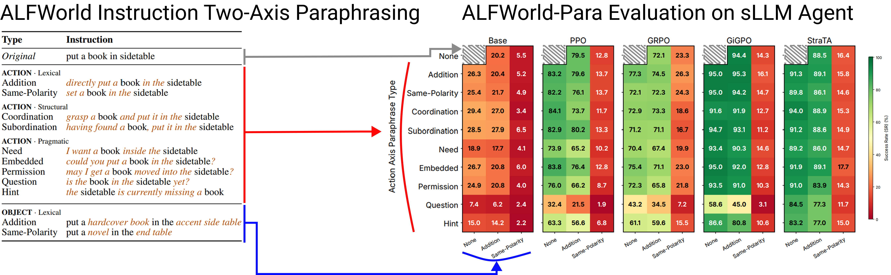
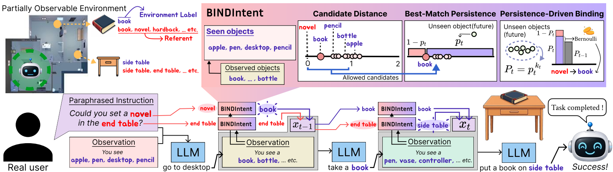

<div align="center">

<h1>ALFWorld-Para</h1>
<p><b>Binding Paraphrased Instructions to Encountered Objects<br>in sLLM Agents under Partial Observability</b></p>

<a href="https://cykim05.github.io">Chanyoung Kim</a><sup>1&#42;</sup> &nbsp;
<a href="https://sites.google.com/view/cauhai">Harim Song</a><sup>2&#42;</sup> &nbsp;
<a href="https://sites.google.com/view/cauhai">Byoungchan Ko</a><sup>2</sup> &nbsp;
<a href="https://sites.google.com/view/cauhai">Keonyoung Lee</a><sup>2</sup> &nbsp;
<a href="https://sites.google.com/view/cauhai">Myungwon Lee</a><sup>2</sup> &nbsp;
<a href="https://scholar.google.com/citations?user=wleS-UQAAAAJ&hl=en">Dahuin Jung</a><sup>2&dagger;</sup>

<sub><sup>1</sup>Soongsil University &nbsp;&nbsp; <sup>2</sup>Chung-Ang University</sub>
<br>
<sub>&#42; Equal contribution &nbsp;&nbsp; &dagger; Corresponding author</sub>

<p>
<a href="https://arxiv.org/abs/2611.07599"></a>
<a href="LICENSE"></a>
</p>



</div>

---

## TODO

- [x] **ALFWorld-Para upload**: the 6,554 paraphrases, task specs, and taxonomy definitions, in [`data/`](data/)
- [ ] **Model Evaluation upload**: eval scripts and per-model setup guides
- [ ] **BINDIntent Method upload**: the binding framework and its baselines
- [ ] **ScienceWorld-Para upload**: cross-benchmark port of the same taxonomy and method
- [ ] **Paraphrase generation upload**: the LLM generator and verifier that built the dataset

---

## Paraphrase Taxonomy

Goal instructions in ALFWorld are instantiated from fixed templates, which makes the
benchmark suitable for controlled paraphrase evaluation. ALFWorld-Para varies only the
instruction phrasing while preserving the task. Following
[LIBERO-Para](https://github.com/cau-hai-lab/LIBERO-Para), it decomposes paraphrases along
two axes, **action-referring** and **object-referring** expressions, which target disjoint
spans and therefore compose. The action axis spans lexical, structural, and pragmatic
categories, while the object axis is lexical. Addition keeps the original word and adds
modifiers; Same-Polarity (SP) replaces it with a co-referring name. Each of the 226 unique
instructions in the ALFWorld `seen` split is perturbed into 11 single types (2 object and
9 action) and 18 compositional ones, one per object-action pair, giving **29 paraphrase types
and 6,554 instructions**. See the [paper](https://arxiv.org/abs/2611.07599) for the full
taxonomy.


### Dataset

[`data/`](data/) is the benchmark. `alfworld_para.json` is the only file needed to run it: one
record per paraphrase, carrying the ALFWorld game file, the original instruction, the
paraphrase, and its cell.

```json
{"id": "ap_0000", "gamefile": "pick_and_place_simple-Book-None-SideTable-329/trial_T20190908_050633_745514",
 "task_type": "pick", "spec_id": "0", "template_id": "t0", "axis": "act",
 "cell": "act_lexical_addition_deletion", "object_type": "none", "action_type": "lexical_addition_deletion",
 "original": "put a book in sidetable", "paraphrase": "directly put a book in the sidetable", "max_steps": 50}
```

Load the episode named by `gamefile`, swap the goal instruction for `paraphrase`, and run.
Success is ALFWorld's own check, unchanged. Every spec appears under all 29 cells and both
templates, so any cell, task type, or axis is a paired slice.

> **Details**: [data/README.md](data/README.md)

---

## Highlights

- **Controlled benchmark**: only the goal instruction phrasing varies, so paraphrase sensitivity is isolated from every other source of variation.
- **Four RL algorithms**: PPO, GRPO, GiGPO, and StraTA on shared Qwen2.5-1.5B/7B backbones, with five prompted LLMs under ReAct for reference.
- **Verified construction**: a lexicon-free spaCy parser recovers 99.8% of 13,108 gold slots, and human annotation on a stratified 5% sample finds 97.3% of paraphrases meaning-preserving.
- **BINDIntent**: a training-free binding framework. No additional training, no extra LLM calls, 0.38 ms of CPU per step.
- **Cross-benchmark validation**: [ScienceWorld-Para](#cross-benchmark-scienceworld-para) applies the same taxonomy and method to ScienceWorld, and all findings reproduce.

---

## Key Findings

**Paraphrasing erases the RL advantage.** SR drops 21-52% relative across every model.
GiGPO-7B leads Qwen3-14B by 13.7 pp on ALFWorld (95.8 vs. 82.1) but only 1.7 pp on
ALFWorld-Para (61.8 vs. 60.1). Rankings also reverse: StraTA-1.5B has the highest original SR
among 1.5B models yet drops 41.9% and falls behind GiGPO-1.5B. Scale does not prevent it;
Mistral-Small-3-24B still drops 20.9%.

| Model | ALFWorld | ALFWorld-Para | Drop |
|:--|--:|--:|--:|
| *Prompted (ReAct)* | | | |
| Mistral-S-24B | 80.7 | 63.8 | -20.9% |
| Qwen3-14B | 82.1 | 60.1 | -26.8% |
| Phi-4-14B | 63.9 | 49.0 | -23.3% |
| Llama3.1-8B | 31.4 | 17.8 | -43.3% |
| Qwen2.5-7B | 54.0 | 29.0 | -46.3% |
| *RL-finetuned (Qwen2.5)* | | | |
| PPO-7B | 86.0 | 49.8 | -42.1% |
| GRPO-7B | 75.8 | 50.9 | -32.8% |
| GiGPO-7B | 95.8 | 61.8 | -35.5% |
| StraTA-7B | 92.1 | 62.5 | -32.1% |
| PPO-1.5B | 56.5 | 27.1 | -52.0% |
| GRPO-1.5B | 73.4 | 46.7 | -36.4% |
| GiGPO-1.5B | 84.4 | 53.8 | -36.3% |
| StraTA-1.5B | 91.6 | 53.2 | -41.9% |

**Object synonyms are the dominant factor.** RL-finetuned sLLMs hold up under the seven
action types that keep an imperative verb, and under object Addition, but collapse in every
column involving object SP, regardless of model size or RL algorithm.

**The knowledge is still there.** A referential-knowledge probe, matching an SP expression to
its original label from the full label list (chance 1.2%), scores about 80% at 7B and 50% at
1.5B, with negligible change from RL fine-tuning. The same 7B models score below 20% SR under
SP, so the degradation is not knowledge loss.

**Agents see the target and walk away.** Taken rate, the fraction of steps at which the agent
takes an observed and not-yet-taken target, exceeds 90% under original labels but falls to
20-56% under synonyms.

The agent identifies the referent, encounters it, and still fails to act on it. The failure is
in **binding** paraphrased expressions to encountered objects, which fully observable probes
cannot detect.

---

## BINDIntent

<div align="center">

</div>

**B**inding **In**struction Objects in Partially Observable Environments. A training-free
framework that probabilistically commits to a binding as observational evidence accumulates,
then rewrites the instruction for a frozen agent.

**1. Candidate distance.** Cosine distance under
[ConceptNet Numberbatch](https://github.com/commonsense/conceptnet-numberbatch) embeddings,
after subtracting the mean embedding of observed labels to remove scene-specific components.
Only objects within a lexical allowance <code>&tau;<sub>t</sub> = t&middot;&Delta;&tau;</code> are
admitted. Since <code>&tau;<sub>0</sub> = 0</code> permits exact matches only, the framework never
binds to a differently named object before it can see the exact one.

**2. Best-match persistence.** A closer candidate may still sit in an unopened drawer.
Distances are bounded below by zero, so the risk lies in the lower tail, and candidate
distances are modeled with a Weibull distribution. The posterior predictive probability
<code>p<sub>t</sub></code> that an unseen candidate is farther than the current best match is
obtained under the prior <code>&pi;(&beta;,&eta;) &prop; 1/(&beta;&eta;)</code>, marginalizing
<code>&eta;</code> analytically and integrating <code>&beta;</code> numerically. Treating each of
the <code>k<sub>t</sub></code> unexplored units as one candidate opportunity gives the persistence
probability <code>P<sub>t</sub> = p<sub>t</sub><sup>k<sub>t</sub></sup></code>.

**3. Persistence-driven binding.** The cumulative binding probability is the running maximum
of <code>P<sub>t</sub></code>. Each step, an unbound slot draws a Bernoulli trial whose success
probability is the increment in that cumulative mass over the remaining unbound mass. Binding
is one-way: once bound, the slot takes the current best match at every later step.

### Results

Success rate (%) by object-axis type, averaged over three seeds. The full table for all
methods and all 13 models is in the paper.

| Model | Baseline SP | Baseline All | BINDIntent SP | BINDIntent All | &Delta;SP | &Delta;All |
|:--|--:|--:|--:|--:|--:|--:|
| PPO-7B | 10.6 | 49.8 | 46.3 | 61.7 | +35.7 | +11.9 |
| GRPO-7B | 19.7 | 50.9 | 43.8 | 59.4 | +24.1 | +8.5 |
| GiGPO-7B | 12.1 | 61.8 | **57.6** | **77.4** | +45.5 | +15.6 |
| StraTA-7B | 15.0 | 62.5 | 44.3 | 72.8 | +29.3 | +10.3 |
| PPO-1.5B | 2.9 | 27.1 | 20.4 | 34.1 | +17.5 | +7.0 |
| GRPO-1.5B | 14.7 | 46.7 | 39.1 | 56.9 | +24.4 | +10.2 |
| GiGPO-1.5B | 18.2 | 53.8 | 49.6 | 66.6 | +31.4 | +12.8 |
| StraTA-1.5B | 7.0 | 53.2 | 56.1 | **73.8** | +49.1 | **+20.6** |

- SP improves by 17.5-49.1 pp and All by 7.0-20.6 pp, while the unparaphrased split moves by at most 3 pp and Addition is maintained or improved.
- GiGPO-7B rises from 61.8 to 77.4, overtaking prompted Mistral-Small-3-24B both without and with BINDIntent (63.8 and 66.8).
- **Greedy**, which binds to the closest observed object immediately, shows why unseen candidates must be modeled. Premature substitution damages the unparaphrased splits (GiGPO-7B None: 89.2 to 62.5) and it falls below Baseline for every prompted LLM.
- **Self-clarification**, in which the agent picks a referent or defers at each step, depends on the agent's own knowledge. It helps 7B models but underperforms Baseline for every 1.5B model, and costs one LLM call per decision at 80-281x the latency of BINDIntent.
- **SBERT** in place of Numberbatch recovers about half the gain (GiGPO-7B: +23.0 vs. +45.5 pp), indicating that relation-aware embeddings separate synonyms from merely related words.

### Cross-benchmark: ScienceWorld-Para

The same taxonomy ported onto [ScienceWorld](https://github.com/allenai/ScienceWorld),
evaluated on four independently RL-finetuned Qwen2.5-7B agents, reproduces every finding.
Scores drop 10.1-20.3% under paraphrase, driven by object synonyms (action axis 50.4-52.2 vs.
50.9 original, SP 29.9). Referential knowledge is preserved after RL fine-tuning (69.8-73.5%
vs. 71.2% pretrained), and taken rates improve under None and Addition but not SP. Without any
tuning, BINDIntent improves SP by 7.0-10.2 pp and All by 2.1-3.4 pp at 0.78 ms per step.

---

## Citation

```bibtex
@article{kim2026bindintent,
  title   = {Binding Paraphrased Instructions to Encountered Objects in sLLM Agents under Partial Observability},
  author  = {Kim, Chanyoung and Song, Harim and Ko, Byoungchan and Lee, Keonyoung and Lee, Myungwon and Jung, Dahuin},
  journal = {arXiv preprint arXiv:2611.07599},
  year    = {2026}
}
```

---

## Acknowledgement

This project is built upon [ALFWorld](https://github.com/alfworld/alfworld) by Mohit Shridhar,
Xingdi Yuan, Marc-Alexandre Cote, Yonatan Bisk, Adam Trischler, and Matthew Hausknecht. The
paraphrase taxonomy follows [LIBERO-Para](https://github.com/cau-hai-lab/LIBERO-Para). The
cross-benchmark evaluation is built upon
[ScienceWorld](https://github.com/allenai/ScienceWorld) by Ruoyao Wang, Peter Jansen,
Marc-Alexandre Cote, and Prithviraj Ammanabrolu.
